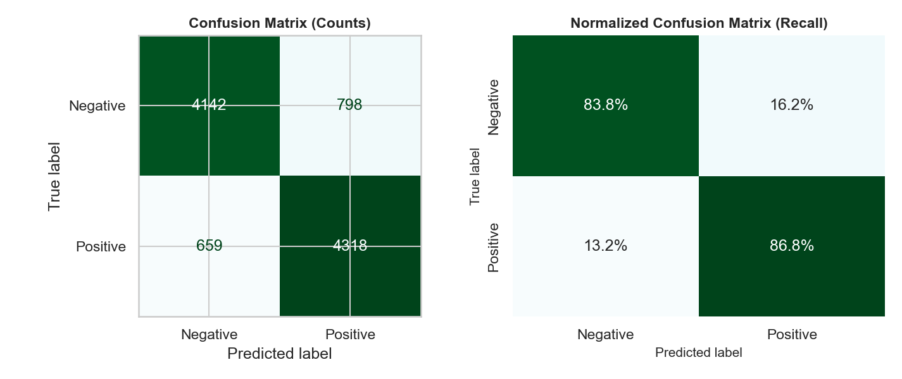
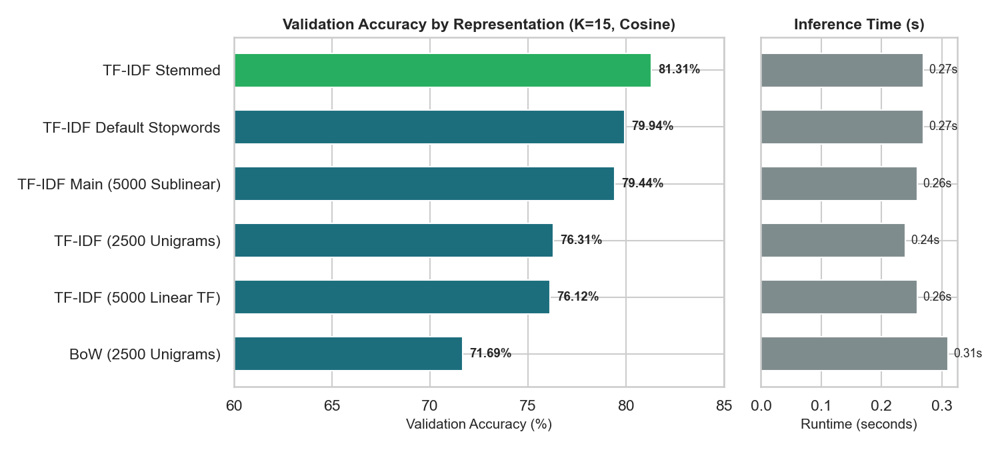
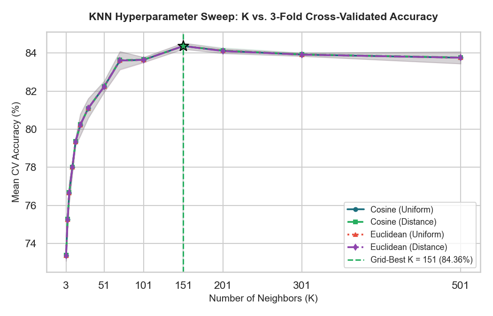

# KNN Sentiment Classifier for IMDB Movie Reviews

Binary sentiment classification (positive / negative) of 49,582 IMDB reviews using **K-Nearest Neighbours on TF-IDF features**, with a study of how the text representation affects accuracy.

> **Context:** This is my individual component of a 6-member group project for **IT2011 – Artificial Intelligence and Machine Learning** at SLIIT (Year 2, Semester 1, 2026). Each member built one model family (Logistic Regression, Linear SVM, Decision Tree, Random Forest, KNN, LSTM). This repository contains only my KNN work and the preprocessing it needs.

## Results

Held-out test set: 9,917 reviews, evaluated once after the final model was fixed.

| Metric | KNN | Majority baseline |
|---|---|---|
| Accuracy | **0.8531** | 0.5019 |
| Precision | 0.8440 | |
| Recall | 0.8676 | |
| F1 | 0.8556 | |
| ROC-AUC | 0.9308 | |

Final model: `n_neighbors=201`, `metric="cosine"`, `weights="uniform"`, TF-IDF (1–2 grams, 5,000 features, sublinear TF).

Confusion matrix: 4,142 TN, 798 FP, 659 FN, 4,318 TP.



## What I did

1. **Data audit** (`notebooks/imdb_dataset_audit.ipynb`): checked nulls, class balance, review length and HTML artifacts. Found 418 exact duplicates.
2. **Preprocessing** (`preprocessing/data_preprocessing.ipynb`):
   - Removed duplicates **before** the stratified 80/20 split (39,665 train / 9,917 test, `random_state=42`) so duplicated reviews cannot leak into the test set.
   - Cleaned text in a fixed order: HTML tags, Unicode normalisation, contraction expansion, lowercasing, stopword removal with a **negation whitelist** (so *not*, *never*, *no* are kept).
   - Fitted every vectoriser on training data only.
3. **Representation study** (`notebooks/knn_model.ipynb`, section 4): compared six text representations with the algorithm held fixed (K=15, cosine).
4. **Tuning**: `GridSearchCV` (3-fold) over K, weights and metric on an 8,000-row training subsample, because brute-force KNN is slow on the full set. The chosen K was then checked on a larger 80/20 split of the full training set.
5. **Evaluation**: metrics, confusion matrices, ROC curve and a qualitative error analysis with neighbourhood diagnostics.

## Representation study

5-fold CV accuracy on the 8,000-row tuning subsample (KNN, K=15, cosine):

| Representation | Mean CV accuracy |
|---|---|
| Bag-of-words (2,500 unigrams) | 72.19% |
| TF-IDF (2,500 unigrams) | 75.65% |
| TF-IDF (5,000, 1–2 grams, linear TF) | 75.88% |
| TF-IDF (5,000, 1–2 grams, sublinear TF) | 79.55% |
| TF-IDF stemmed | 80.06% |
| TF-IDF, default stopword list (drops negations) | 79.01% |

Changing only the text representation moved KNN by about 8 points, which is more than most hyperparameter changes. The top three variants are within about 1 point of each other, which is close to fold-to-fold variation, so I do not claim stemming is clearly better.



## Hyperparameter tuning

Best grid result was K=151 (CV accuracy 84.36%). On the larger validation split, K=301 scored highest (84.53%) but K=201 was within 0.14 points (84.39%), so I chose K=201. Cosine vs Euclidean made no real difference, because TF-IDF vectors are L2-normalised, which makes the two metrics rank neighbours identically.



## Error analysis

Misclassified reviews had similar length to correct ones (median 180 vs 171 words), so length was not a major factor here. The false positives I inspected were mixed reviews with praise words (for example about the songs) that outweighed the negative verdict. KNN only compares word overlap, so it cannot weigh which part of a review carries the verdict.

## Limitations

- Tuning used an 8,000-row subsample, so the optimal K for the full training set may differ slightly.
- KNN is slow at prediction time (about 9 s for 9,917 reviews with brute-force cosine search).
- The error-analysis explanations are hypotheses from reading a few snippets, not tested causes.
- The dataset has no neutral reviews and covers English movie reviews only.

## Reproduce

```bash
git clone https://github.com/JanupaG/imdb-sentiment-knn.git
cd imdb-sentiment-knn
pip install -r requirements.txt
```

1. Download `IMDB Dataset.csv` from [Kaggle](https://www.kaggle.com/datasets/lakshmi25npathi/imdb-dataset-of-50k-movie-reviews) into `data/raw/`.
2. Run the notebooks in order, **from inside their own folder** (they use `Path.cwd().parent` as the project root):
   1. `preprocessing/data_preprocessing.ipynb` (creates `data/processed/`)
   2. `notebooks/imdb_dataset_audit.ipynb` (optional)
   3. `notebooks/knn_model.ipynb` (creates `results/`)

Developed with Python 3.13 and scikit-learn 1.8.

## Repository layout

```
notebooks/        audit and KNN model notebooks
preprocessing/    cleaning, split and vectorisation pipeline
results/          figures and knn_metrics.json
data/raw/         put the Kaggle CSV here (not included)
```

## Dataset

IMDB Large Movie Review Dataset: Maas et al., "Learning Word Vectors for Sentiment Analysis", ACL 2011. Kaggle copy by Lakshmi Narayanan. The dataset is not redistributed here.
